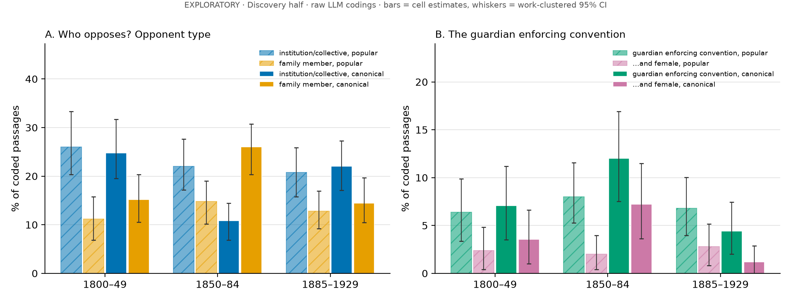
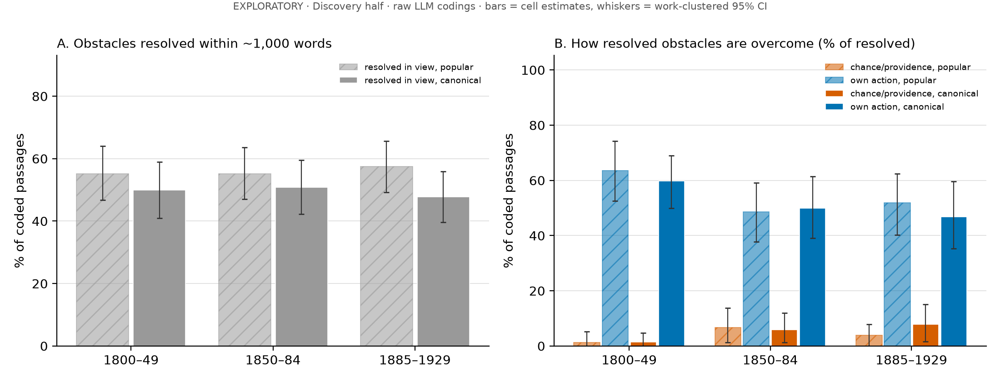

# EXPLORATORY: "Who stands in the way?" and "How are obstacles overcome?" (2026-11-04)

> **Status: exploratory, not pre-registered, Discovery half only.** These analyses follow the literary review's
> redirection ideas R2 and R3 (`docs/review/literary_review.md`). Under `docs/prereg.md` §5.8 they are exploratory.
> No Confirmation or sealed data was read. Every coding here is a **raw LLM coding** (Claude sub-agents) with no human
> correction, so nothing below is a result for citation. A confirmatory test (pre-registered, human-validated, run on
> Confirmation) is still owed.

Code: `analysis/explore_who_resolution.py` (`prepare`, `reliability`, `check`, `analyze`). Coder prompts:
`analysis/explore_who_prompts/scheme_{a,b}.txt`. Data, which is not committed, lives in `data/work/explore_who/`: the
blinded batches, the private id key `key_{a,b}.parquet`, coder outputs in `out/`, `manifest.json`, and the raw
analysis output `analysis_out.md`. Figures: `analysis/figs/explore_who.png` and `analysis/figs/explore_resolution.png`.

## 0. Design

**Frame.**
- Labels: v0.9 `label` rows, pin `41ca3c7d`, random backbone (`rand_a` and `rand_b`, without `_dup` twins), valid
  schema, `has_obstacle = yes`.
- Works: `works_v2.split_v2 == 'discovery'`, `era_v2` set and `date_exclusion` null.
- Snapshot: 58,910 obstacle passages (the DB was syncing, so `manifest.json` freezes the counts).

**Strata.** Six cells: `era_v2` (E 1800–49, M 1850–84, L 1885–1929) × `canonical` (`canon.parquet`, sitelinks ≥ 30,
house names excluded). In each cell, passages were shuffled with seed 20261104, at most 3 were kept per work, and a
fixed number was drawn. All-era and all-canon figures reweight the cells to their frame sizes (`w = N_cell / n_cell`).

| | A: "who" | B: "resolution" |
|---|---|---|
| Frame | obstacles whose `domains` include INTERPERSONAL_CONFLICT, SOCIAL_RANK_CONVENTION, MONEY_PROPERTY_LAW or COMMUNICATION_INFORMATION (43,309) | all obstacles (58,910) |
| Sample | 1,448 passages from 988 works (250 per cell; E-canonical has 198 because of the per-work cap) | 804 passages from 619 works (134 per cell) |
| Coder input | passage text only (~350 words) | passage + `obstacle_summary` (a 10-word generic description from v0.9) + the **following text**: `ctx_after` plus the next two passage-length windows from `data/work/clean/<pg_id>.txt` (≈ 800 words, so ≈ 1,150 words in all) |
| Coders | 29 sub-agents, 50 passages each | 21 sub-agents, 40 each |

**Blinding.**
- Every passage gets an opaque hashed id. Batches mix all strata in random order.
- Coders saw no title, author, year, genre or canon flag, and were told not to identify the book.
- At most 8 coders ran at once, and each read its own batch only.

**Reliability.**
- 100 A passages and 40 B passages were re-coded by 3 fresh sub-agents that never saw the first pass.
- This is **LLM–LLM** agreement. It measures how stable the coding is, not whether it is valid.

**Inference.** CIs come from a work-clustered bootstrap: works are resampled within each sampling cell, with 1,000
replicates and percentile 95% intervals. The L − E contrasts and the canonical-minus-popular difference-in-differences
(DiD) are bootstrapped the same way. Nothing is multiplicity-corrected. With roughly 40 contrasts in this document,
expect about two "significant" ones by chance.

**Reliability (independent re-coding):**

| A field | agreement | κ | | B field | agreement | κ |
|---|---|---|---|---|---|---|
| opponent_type | 89% | 0.84 | | resolved_in_view | 95% | 0.91 |
| role | 84% | 0.81 | | means | 92% | 0.89 |
| opponent_gender | 91% | 0.84 | | chance/providence | 98% (1 disagreement in 40; too rare for κ) | – |
| acts_for | 79% | 0.71 | | | | |
| protagonist_gender | 93% | 0.85 | | | | |
| guardian-enforcing-convention (derived) | 97% | 0.81 | | | | |
| institution/collective (derived) | 94% | 0.84 | | | | |

`acts_for` (self-interest vs. convention vs. institution) is the softest field.

---

## A. Who stands in the way?

**Overall (cell-weighted, all eras).**
- Opponent type:
  - an individual non-relative: 51%;
  - a family member: 14%;
  - a collective (mob, "society", a gang, a tribe): 14%;
  - an institution: **7%**;
  - nobody (the v0.9 "social" domain had no agent behind it): 14%.
- Commonest roles: villain/criminal 11%, parent 7%, suitor/rival 7%, official/police/lawyer 6%, aunt/guardian 4%,
  spouse 4%.

### A1. Institutions do not replace persons

| Opponent is an institution or collective | Popular | Canonical | All |
|---|---|---|---|
| 1800–49 | 26% [21, 32] | 25% [19, 31] | 26% [21, 30] |
| 1850–84 | 22% [17, 28] | 11% [7, 15] | 19% [16, 24] |
| 1885–1929 | 21% [16, 26] | 22% [16, 27] | 21% [17, 26] |

- **L − E: −5 pp [−11, +3]** overall. Institutions alone: −2 pp [−6, +1].
- Officials, police and lawyers as the opponent fall from 11% to 5% of coded passages.
- The Galsworthy line ("A system recognises only causes which you can see") does not generalize, at least at the scale
  of a 350-word page. If anything, persons *gain* ground slightly.
- The one sharp cell is the **mid-Victorian canon**. It has the fewest impersonal opponents (11%) and the most family
  opponents (26%, against 15% in popular fiction of the same years). It is the most domestic cell in the sample.

### A2. The guardian enforcing convention: a mid-Victorian canonical figure, not a long decline

| Parent/aunt/guardian enforcing a rule or convention | Popular | Canonical |
|---|---|---|
| 1800–49 | 6% [4, 10] | 7% [4, 11] |
| 1850–84 | 8% [5, 11] | **12% [7, 17]** |
| 1885–1929 | 7% [4, 10] | 4% [2, 7] |
| …and female | | |
| 1800–49 | 2% [1, 5] | 4% [1, 7] |
| 1850–84 | 2% [0, 4] | **7% [3, 12]** |
| 1885–1929 | 3% [1, 5] | 1% [0, 3] |

- The figure is **a canonical-novel figure that declines**, but only after a mid-century peak.
  - In canonical fiction it rises to 12% of social obstacles in 1850–84 (7% when the guardian is female: Trollope's
    aunts and mothers), then drops to 4% (1%) after 1885.
  - Popular fiction holds a flat 6–8% throughout.
  - The canonical L − E change is −3 pp [−8, +2] and the DiD is −3 pp [−10, +3]. The interval is too wide to
    distinguish from zero. The **M → L** drop in the canon is the visible movement (12% → 4%).
- **The wicked aunt is real, but she is not the typical enforcer.**
  - Only 43% of guardian-enforcers are female. Fathers and uncles enforce convention more often.
  - Female share by role: aunt/guardian 46% (n = 65), parent 36%, servant 41%, villain 5%, official 0%.
- **Convention-enforcing opponents in general decline**: 20% → 22% → 14%, L − E −6 pp [−11, −1]. In popular fiction
  the drop is −7 pp [−14, −1]. Canonical fiction again peaks mid-century, at 30% [24, 36].
- Villains rise slightly in the canon: +5 pp [+1, +10].

### A3. Gender

- **Women are a quarter of opponents, whoever is blocked.** Among person and family opponents, 24% [17, 32] are female
  when the blocked character is female, and 25% [18, 31] when he is male. The female-opponent share is flat across
  eras (27% → 25% → 23%), except for the mid-Victorian canon (36%).
- **Who is blocked changes.** The blocked protagonist is female in 25% → 34% → 36% of passages (L − E +11 pp
  [+4, +18]). The rise is driven by **popular** fiction (+14 pp [+6, +23]). Canonical fiction peaks in 1850–84 (44%)
  and falls back to 28%. The DiD is −15 pp [−27, −2], the strongest contrast in this section. Late popular fiction
  includes girls' series fiction (Penrose, Emerson, Hope), which plausibly drives part of the rise. This was not
  tested.

### A4. A by-product: RANK vs. INTERPERSONAL

When v0.9 put SOCIAL_RANK_CONVENTION in `domains`, the coder found the opponent enforcing a rule or convention in only
**33%** of cases. In 34% the opponent was acting from self-interest. This supports review P5: the RANK/INTERPERSONAL
line in the codebook is unstable, and the agent/norm split (`acts_for`) separates the two more cleanly.

---

## B. How are obstacles overcome?

- **About half of scene-level obstacles are resolved within ≈ 1,150 words**: 53% / 54% / 57% by era, flat. Canonical
  works resolve slightly less often (48–51%) than popular ones (55–57%).
- Means, among the 424 resolved, cell-weighted:

| own action | another person | time/delay | chance | institution | providence | technology |
|---|---|---|---|---|---|---|
| **51.5%** | **35.8%** | 7.0% | 3.9% | 1.2% | 0.6% | 0.1% |

- Technology is the *main* means only once. It is a **secondary** means (`means2`) in 13 of 804 cases: the arriving
  telegram, the letter that brings the news. Read for function, the machine is almost never the deus ex machina here
  either.

### B1. Vargish/Dannenberg: no decline of chance or providence at scene level

| Chance or providence, % of resolved | Popular | Canonical |
|---|---|---|
| 1800–49 | 1% [0, 5] (1/74) | 1% [0, 5] (1/67) |
| 1850–84 | 7% [1, 14] (5/74) | 6% [1, 12] (4/68) |
| 1885–1929 | 4% [0, 9] (3/77) | 8% [2, 15] (5/64) |

- **L − E: +3 pp [−1, +8]** overall, and +6 pp [−0, +14] in the canon. Canonical chance alone is +8 pp [+2, +15]. The
  DiD is +4 pp [−5, +13].
- The predicted decline does not appear. If anything, chance resolutions are slightly *more* common late, and only in
  the canon: Wodehouse, Wallace, Galsworthy and Henry James's *Sacred Fount* supply late-canonical coincidences.
- **Explicit providence is almost absent.** There are 6 cases in 804. Four of them are mid-century popular, often
  evangelical or tract fiction (A.L.O.E., Mrs Oliphant, Blackmore). Bret Harte's one "Providence" is ironic.
- **Agency.** The character's own action falls from 62% to 49–52% of resolutions (L − E −11 pp [−25, +3]). That runs
  against a "rise of agency" story, but the interval is wide.
- Sensitivity checks agree:
  - registered-primary works only: chance/providence L − E +0 pp [−6, +6];
  - excluding historical-setting and juvenile works: +1 pp [−5, +8].
- **Reading.** Vargish's providential aesthetic is a claim about **plot architecture**: the dénouement, the hidden will,
  the restored heir. A random 350-word window plus about 800 words of follow-on text sees the *local* fix: a friend
  helps, the hero climbs out. At that scale chance and providence are rare in every period, roughly 1–8% of resolutions.
  This is a **scale finding, not a refutation**. The test needs chapter-end or novel-end sampling, as review R3 says.

---

## Exemplars (quotes verified verbatim against `data/work/clean/<pg_id>.txt`)

1. **The aunt as jailer.** Trollope, *Ayala's Angel* (1881; canonical, M). Lucy has been sent to live with her Aunt
   Dosett:
   > "It seemed to her that the same decree which had admitted Ayala into the golden halls of the fairies had doomed
   > her not only to poverty, but to slavery. There was no escape for her from her aunt and her aunt's sermons."

2. **The mother enforcing propriety.** Trollope, *Mr. Scarborough's Family* (1883; canonical, M):
   > "It is not at all a proper thing that a young gentleman should come and address a young lady in this way behind
   > her only parent's back."

3. **The aunt's instruction, comically relayed.** Irving, *The Alhambra* (1832; canonical, E). The girl at the door
   says:
   > "Santa Maria! It is against you cavaliers of the court my aunt has charged me especially to bar the door."

4. **The system as opponent: the late canonical institution.** Dreiser, *The Financier* (1912; canonical, L). This is
   one of the few institutional opponents:
   > "The attorney-general and the State treasurer are hand in glove with them. Even if I put in a bid, and can
   > demonstrate that I can handle the loan, it won’t help me to get it."

5. **Resolution by a convenient death (chance).** George Eliot, *Felix Holt* (1866; canonical, M). Mrs Transome's
   blocked hopes for Harold are released, in the following text, by:
   > "The news came from Jersey that Durfey, the imbecile son, was dead. _Now_ Harold was heir to the estate"

6. **Providence, ironically.** Bret Harte, "The Twins of Table Mountain" (1868; canonical, M). A young woman's dignity
   is rescued:
   > "And then Providence assisted her with the sudden presentation of two figures, a man and woman, slowly climbing up
   > over the mountain verge"

7. **The machine as deus (chance + technology).** Edgar Wallace, *Diana of Kara-Kara* (1924; canonical, L). The bank
   has just refused an overdraft:
   > "Eleanor came in with a telegram, and the girl opened it quickly. “Saved!” she whooped."

   The telegram reports that the dreaded suitor has measles. "Thank God for measles!"

8. **The modal case: own action.** Austen, *Emma* (1815; canonical, E). Emma ends Mr Elton's unwanted proposal
   herself:
   > "He was too angry to say another word; her manner too decided to invite supplication"

The quotes in exemplars 1–4 and 6 are inside the coded passage. Those in 5, 7 and 8 are in the following text. Quote
marks and apostrophes are reproduced as they appear in the PG text.

---

## Limitations

- **Raw LLM codings.** Every code comes from a Claude sub-agent with no human gold. The re-coding κ values (0.71–0.91)
  show the codes are *stable*, not that they are *right*. Two runs of the same model family share its biases, for
  example how it reads irony (Harte) or personified Duty (review P3). A human check of about 100 A rows and 60 B rows
  is needed before any of this is quoted.
- **Inherits v0.9 errors.** Both samples are conditioned on v0.9 `has_obstacle = yes`, and A on v0.9 `domains`.
  - In 14% of A rows the coder found **no** agent at all. These are v0.9 false positives, or "social" obstacles that are
    really poverty or ignorance.
  - B coders sometimes recoded the obstacle when the v0.9 summary did not fit. Coders flagged more than a dozen such cases.
- **Exploratory and unadjusted.** Nothing was pre-registered, and about 40 contrasts were inspected. The two
  "significant" headline contrasts are the female-protagonist DiD (−15 pp [−27, −2]) and the convention decline
  (−6 pp [−11, −1]). Either could be a false positive.
- **Discovery only.** The same authors' works recur within a half, and E-canonical rests on 67 works (198 passages for
  A, 134 for B). A confirmatory test on Confirmation is required.
- **Scale.** These are random 350-word windows, and B looks only about 800 words ahead. That suits the "local
  impediment" construct (review P2) but not plot-level resolution (Vargish). The B1 null is about scene-level fixes.
- **Small counts.** Chance and providence total 19 of 424 resolutions, and providence 6, so cell CIs are wide. The
  per-work cap of 3 means within-cell draws are not simple random samples. Cell weights fix cell composition only.
- **Canon measure.** `canonical` is Wikipedia-sitelinks fame (`docs/canon_measure.md` §2.3). It counts Wallace, Orczy
  and Dreiser as canonical, which is part of why "late canonical chance" looks the way it does.
- **Gender** is coded from the passage alone. "Unknown" protagonists (37 of 1,448, 2.6%) are left out of the
  numerator of the female share but kept in its denominator.

## What would make this confirmatory

1. Freeze the A and B schemes as they stand (`analysis/explore_who_prompts/`).
2. Pre-register three hypotheses:
   - the M-canonical guardian peak and its M → L decline;
   - the female-protagonist DiD;
   - for B, a chapter-end sample, not random windows.
3. Collect human double-coding on about 150 items.
4. Run once on Confirmation after the unseal.
