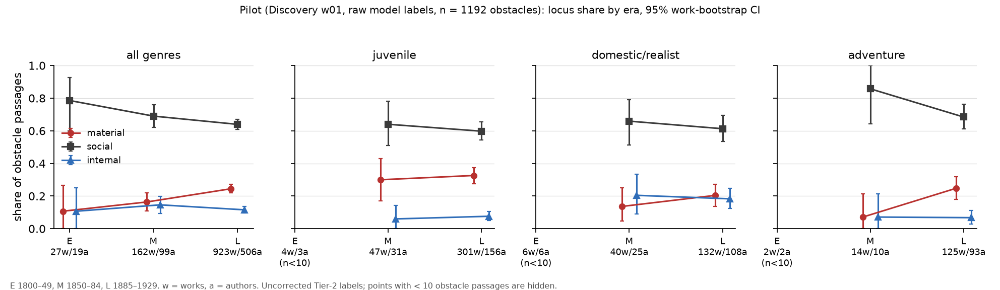

# Pilot analysis 1: is the material-locus rise real, and should H1 change? (2026-11-01)

**Data.** Discovery half only, wave w01 (random backbone): 1,361 labelled passages from 1,259 works, of which 1,192 are obstacles. Labels come from the pinned Tier-2 model (gemma4 12B, codebook v0.5) with **no human correction**. The prereg simulation (§7.2) shows that naive labels are biased, and QA pass 2 (`docs/qa/label_pass_2.md`) finds yes-precision of about 0.77. So everything below is evidence about **direction and robustness only**. None of it is an effect size.

**Code.**
- `pipeline/genre.py` writes `data/work/genre.parquet`.
- `analysis/pilot_analysis_1.py --fig` produces every number here and `analysis/figs/pilot_locus.png`. Seeds are fixed, and bootstrap CIs use B = 1000 resamples over works, stratified by era.

**Eras.** E = 1800–1849, M = 1850–1884, L = 1885–1929, cut on `works.year` as in the prereg. The brief's 33 / 262 / 1,066 counts came from decade cuts, which put the 1880s in M. Under decade cuts the material shares are 0.107 / 0.170 / 0.248, so the pattern does not change.

| Era | Passages | Obstacles | Works | Authors | has_obstacle | Material | Social | Internal |
|---|---|---|---|---|---|---|---|---|
| E | 33 | 28 | 31 | 21 | 0.85 | 0.11 [0.00, 0.27] | 0.79 [0.59, 0.93] | 0.11 [0.00, 0.24] |
| M | 200 | 171 | 188 | 115 | 0.86 | 0.16 [0.11, 0.23] | 0.69 [0.62, 0.76] | 0.15 [0.10, 0.21] |
| L | 1,128 | 993 | 1,040 | 564 | 0.88 | 0.25 [0.22, 0.27] | 0.64 [0.61, 0.67] | 0.12 [0.10, 0.14] |

By decade, the material share is about 0.09–0.15 in the 1850s–1870s, 0.22 in the 1880s, and then flat at 0.24–0.26 from the 1890s to the 1920s. **The move is a step in the 1880s, not a steady trend.** Internal is flat, at 0.10–0.17 in every decade with n ≥ 26.

---

## 1. Genre mapping (`pipeline/genre.py`)

The mapping uses metadata only: LCSH `Subjects`, PG `Bookshelves`, and `year` (for the historical-period rule). No labels are read, so it is safe to run on both halves.

### Classes and precedence
There are 8 classes. The first rule that matches wins.

| Tier | What is matched | Order within the tier |
|---|---|---|
| 0 | No fiction cue in Subjects or Bookshelves | → `other` (`nonfiction_suspect`; workcheck will drop most of these) |
| 1 | LCSH genre/form headings | juvenile > collection (short stories) > sensation/mystery (detective, crime, gothic, ghost, horror) > historical > adventure (incl. sea, western, war, frontier, dime novels) > domestic/realist (form headings: domestic, Bildungsroman, psychological, didactic, political, epistolary) > romance (love stories) > other (sci-fi, fantasy, humour, religious, Christmas, sports) |
| 2 | PG bookshelves | the same order. Shelves are coarse and noisy (e.g. "Category: Historical Novels" on a future-war novel), so they decide only when LCSH names no genre. |
| 3 | LCSH topical headings typical of domestic/realist fiction (social life and customs, families, marriage, man-woman relationships, social classes, clergy, …) | → domestic/realist |
| 4 | Residual fiction | → domestic/realist, tagged `residual_general_fiction` so it can be split out |

**Historical rule.** An LCSH heading of the form "… -- History -- <period> -- Fiction" counts as historical only if the period ends at least 25 years before the work's year. An 1863 Civil War story or a 1917 war novel is about its own time, so it falls through to adventure.

**Why juvenile comes first.** Juvenile is the composition confound named in the brief. The other genres' trends then cannot be driven by boys' adventure that the cataloguers tagged as juvenile.

**Spot check.** I checked 40 works (5 per class, seed 7). After one fix, 37 of 40 are defensible. The three misses are all borderline:
- *Fix applied:* the fiction cue matched "Novelists", so Trollope's *Thackeray* was counted as fiction. It now goes to `nonfiction_suspect`.
- *Wee Macgreegor Enlists* (humour plus WWI) → adventure.
- *Cap'n Abe, Storekeeper* (a Cape Cod comedy-romance) → adventure, because the shelf order puts adventure first.
- *The Mysteries of Montreal* (a physician's memoir-fiction) → residual domestic.

Rules used across the 15,379 works dated 1800–1929: juvenile LCSH 4,408; residual 1,348; LCSH adventure 1,363; LCSH mystery 1,143; non-fiction suspect 780; every other rule ≤ 850.

### Genre × era composition, works per split (metadata only; Confirmation labels never read)

| Genre | Disc E | Disc M | Disc L | Conf E | Conf M | Conf L |
|---|---|---|---|---|---|---|
| juvenile | 25 (9.9%) | 266 (25.4%) | 2,197 (32.6%) | 20 (9.9%) | 387 (**37.0%**) | 1,726 (28.3%) |
| domestic/realist | 44 (17.5%) | 228 (21.8%) | 1,070 (15.9%) | 46 (22.8%) | 191 (18.2%) | 1,090 (17.9%) |
| historical | 77 (**30.6%**) | 147 (14.1%) | 619 (9.2%) | 52 (25.7%) | 103 (9.8%) | 494 (8.1%) |
| adventure | 24 (9.5%) | 97 (9.3%) | 752 (11.2%) | 13 (6.4%) | 86 (8.2%) | 738 (12.1%) |
| other | 42 (16.7%) | 135 (12.9%) | 717 (10.6%) | 36 (17.8%) | 134 (12.8%) | 716 (11.8%) |
| sensation/mystery | 21 (8.3%) | 60 (5.7%) | 573 (8.5%) | 20 (9.9%) | 42 (4.0%) | 544 (8.9%) |
| collection | 10 (4.0%) | 50 (4.8%) | 444 (6.6%) | 10 (5.0%) | 45 (4.3%) | 441 (7.2%) |
| romance | 9 (3.6%) | 63 (6.0%) | 368 (5.5%) | 5 (2.5%) | 59 (5.6%) | 343 (5.6%) |
| total | 252 | 1,046 | 6,740 | 202 | 1,047 | 6,092 |

What the composition shows:
- **PG's fiction from 1850–1929 is about 30% juvenile.**
- The early era is dominated by historical novels (26–31%) and has little juvenile fiction (10%).
- **The two halves differ in the mid era (juvenile 25% vs 37%).** The split was stratified before these genre classes existed, so the standardized (g-computed) estimand in prereg §5.2 is necessary, not optional.

---

## 2. Decomposition on the pilot

### 2a. Shift-share
I used the symmetric Bennet decomposition over the 8 genres, with the share of obstacle passages as weights.

| Contrast | Locus | Total Δ | Within-genre | Composition |
|---|---|---|---|---|
| **M → L** | material | **+8.1** [+1.8, +13.9] | **+7.8** [+1.9, +13.8] | +0.3 [−1.3, +1.9] |
| M → L | social | −5.1 [−12.5, +2.3] | −6.1 [−13.4, +1.0] | +1.1 [−0.8, +3.1] |
| M → L | internal | −3.0 [−9.1, +2.3] | −1.7 [−7.6, +3.7] | −1.3 [−3.0, +0.2] |
| E → L | material | +13.8 [−0.7, +25.5] | +12.2 [+1.2, +21.4]* | +1.6 [−3.9, +7.2] |
| E → L | internal | +0.9 [−11.2, +10.4] | +4.4 [−4.6, +12.3]* | −3.6 [−7.9, +0.5] |

\* In E, every genre cell has 0–12 obstacles, so the E → L within-genre term is not interpretable. It is shown only for completeness.

**At the 8-class level the M → L material rise is entirely within genre.** The genre mix moves (juvenile and adventure up, historical down), but genres differ only modestly in material share, so the mix contributes almost nothing.

Within-genre M → L material differences:

| Genre | Δ | 95% CI |
|---|---|---|
| adventure | +17.7 | [+0.3, +30.5] |
| sensation/mystery | +10.7 | [+4.0, +17.8] |
| other | +15.6 | [+2.4, +27.0] |
| collection | +12.8 | [−18.9, +37.5] |
| romance | +7.9 | [−17.6, +27.6] |
| domestic/realist | +6.8 | [−5.1, +18.9] |
| historical | +3.5 | [−15.2, +17.5] |
| juvenile | +2.6 | [−12.8, +16.4] |

The direction is positive in all 8 genres. Juvenile, the suspected driver, is the flattest.

### 2b. Work-clustered logistic regression
Among obstacles: material vs not ~ era (ref. M) + genre + origin + log length.

| Term | OR | 95% CI (work-clustered) | 95% CI (author-clustered) | p (author) |
|---|---|---|---|---|
| L vs M | 1.61 | [1.03, 2.50] | [0.95, 2.71] | 0.075 |
| E vs M | 0.80 | [0.15, 4.13] | [0.17, 3.85] | 0.78 |

- **Standardized (g-computed) material shares** are E 0.14, M 0.17, L 0.24. L − M = +7.4 pp, with a work-bootstrap CI of [+0.9, +13.4]. L − E has a CI of [−11, +26].
- **Internal:** OR(L vs M) = 0.89 [0.54, 1.47], and the standardized shares are 0.09 / 0.13 / 0.12.
- **Social:** OR(L vs M) = 0.77 [0.53, 1.13].
- Genre ORs for material, relative to domestic/realist: juvenile 1.9, collection 1.8, adventure 1.2, sensation 0.5.

**With author clustering, which is the prereg's clustering unit, the L-vs-M material effect is borderline (p ≈ 0.08).**

### 2c. Robustness strata (M → L material Δ, work-bootstrap CI)

| Stratum | n M / L (obstacles) | Δ (pp) | 95% CI |
|---|---|---|---|
| All | 171 / 993 | +8.1 | [+1.8, +13.9] |
| High-confidence dates only | 60 / 462 | **+14.0** | [+5.5, +21.7] |
| Medium | 58 / 243 | +7.5 | [−3.6, +17.9] |
| Low | 53 / 288 | +1.9 | [−10.7, +14.7] |
| Primary set (high/medium dates, author cap) | 88 / 549 | +10.0 | [+1.8, +17.7] |
| Open Library agrees ±5 y | 19 / 149 | +12.2 | [−1.0, +22.4] |
| Open Library disagrees | 54 / 203 | +0.2 | [−13.1, +13.0] |
| Excluding juvenile + adventure | 107 / 532 | +8.1 | [+0.9, +14.3] |
| No outdoor/frontier/sea/war LCSH subject | 122 / 684 | +7.8 | [+0.1, +14.5] |
| Outdoor subject | 49 / 309 | +8.0 | [−6.1, +19.7] |
| Author has ≥ 10 PG works | 104 / 555 | +10.0 | [+1.4, +18.4] |
| Author has ≤ 3 PG works | 48 / 241 | +9.1 | [−2.4, +19.3] |
| Author has 4–9 PG works | 19 / 197 | −3.5 | [−25.1, +15.8] |
| Single edition | 161 / 965 | +8.7 | [+2.5, +14.8] |
| ≥ 2 editions | 10 / 28 | +2.1 | [−32, +33] (uninformative) |
| Quote verified | 155 / 906 | +8.7 | [+2.4, +14.9] |
| UK / US / unknown origin | | +9.4 / +11.0 / +6.5 | each CI touches 0 |
| Domestic/realist, explicit rules | 28 / 73 | **−2.8** | [−19.0, +12.6] |
| Domestic/realist, residual "general fiction" | 16 / 69 | +19.8 | [+2.2, +34.0] |

**Notes on the strata:**
- **Dates.** The trend is *strongest* where dates are most trustworthy: high confidence, or Open Library agreeing. It vanishes where they are worst: low confidence, or Open Library disagreeing. That is the signature of date noise attenuating a real time pattern, not producing one.
- **Canonicity.** After dedup, `n_editions` is almost always 1, so it is a poor proxy. The name-cloze memorization score is still needed. Prolific PG authors show the rise, and so do authors with few PG works.
- **Domestic/realist.** The class's +6.8 comes from the residual bucket: regional, frontier and lumber-camp novels with no genre heading. Explicitly domestic/psychological novels show no rise. Treat this as a hint of sub-genre composition inside the coarse classes, with tiny n.

### 2d. What the rise is made of
The model's locus follows the codebook's default domain → locus mapping in **93–100%** of obstacles (E 1.00, M 0.93, L 0.96), so "material" here effectively means "first domain is DISTANCE, DARKNESS, NATURE or ILLNESS". Material share by first domain, as pp of all obstacles:

| First domain | M | L | M → L |
|---|---|---|---|
| NATURE_WEATHER | 0.6 | 3.7 | +3.1 |
| DISTANCE_TRAVEL | 4.1 | 6.4 | +2.4 |
| DARKNESS_VISIBILITY | 0.0 | 2.2 | +2.2 |
| ILLNESS_BODY_DEATH | 10.5 | 10.4 | −0.2 |
| other | 1.2 | 1.7 | +0.5 |

- **About 95% of the rise is nature, darkness and travel.** These are the H2b and H2c domains that the plan expected to *fall*. In M they rest on **8 passages**.
- On the social side, SOCIAL_RANK_CONVENTION falls from 30% to 26% and MONEY_PROPERTY_LAW from 16% to 12%. QA pass 2 finds RANK inflated by about 2×.

---

## 3. Critic: alternative explanations

| # | Alternative | Test on pilot | Verdict | How the confirmatory design handles it / what must change |
|---|---|---|---|---|
| 1 | **PG selection**: boys' adventure, westerns and juvenile fiction 1890–1920 | Shift-share composition term +0.3 pp. The rise survives dropping juvenile + adventure (+8.1) and among works without outdoor/frontier/sea/war subjects (+7.8). Juvenile itself is flat. | **Not explained at the 8-class level.** A finer sub-genre drift is still possible: the residual domestic bucket carries the domestic rise. | Genre FE + g-computation (§5.2) and the shift-share (§5.4) handle class-level mix. **Change:** register `pipeline/genre.py` at this commit as the genre variable. Add the battery's "drop each genre ≥ 5%" check, which already exists. Report the residual class separately as a sensitivity. |
| 2 | **Model era bias**: archaic diction read as "social" | Archaism rate (thee/thou/'tis/… per 1k words) does not predict a social label within era: OR 1.05 per log unit, p = 0.70. E's archaism rate is higher (1.13 vs 0.71). QA pass 2: the early era was the *most* accurate, and the errors are late-era adventure/juvenile (animals coded INTERPERSONAL, violence coded ILLNESS → material, forest reverie coded NATURE). | **No sign of archaism bias.** There *is* a late-popular error pattern that inflates late material. | DSL toward human labels removes era-varying model error *if* human error does not vary by era. Prereg §5.1(5) checks this. QA proposals E3/E4 (narrow RANK; locus follows the proximate source) target exactly these errors. |
| 3 | **Over-broad construct**: 87% has_obstacle, flat | QA: the true rate is about 0.71 and precision 0.77. False yeses are mild discomfort, description and banter, mostly in late popular fiction. Overall their locus mix is similar to true obstacles (0.28 / 0.60 / 0.12), **but the mid-era false yeses were mostly material**. QA-corrected M material is 0.03 (n = 14), so the corrected rise is, if anything, *steeper*. | The construct is too loose. This adds noise and an era-varying error mix, and does not by itself make the rise. | **Change:** adopt QA E1 (three-part test plus the "not obstacles" list) in codebook v0.9, subject to the QA A/B gates. The prevalence-based H2b/H2c are the most exposed. |
| 4 | **Date errors** (pg-dates is wrong by > 5 y in 26–29% of the enriched audit sample) | The trend is strongest in high-confidence (+14) and OL-agree (+12) works, and null in low-confidence / OL-disagree works. | **Date error attenuates the trend and does not create it.** | Primary set is high + medium; battery check 4 (high only). **Change:** none needed for H1. Expect the E contrast to be attenuated. |
| 5 | **Early era tiny** (28 obstacles, 19 authors in w01) | E CIs span 0–27 pp. The E → L material Δ is +13.8 [−0.7, +25.5]. **The pilot says nothing about E, which is H1's actual contrast.** All the signal is M → L, and it is a step in the 1880s. | **Decisive.** No redirection may rest on E. | The registered design labels all 24 passages of every early work (§3.3), about 4,800 E passages per half, so this is a w01 artifact. **Do not re-direct H1 on the basis of M → L.** |
| 6 | **Prompt artifacts**: the default locus mapping steers the model | Locus equals the default mapping of the first domain in 93–100% of cases. `locus_reason` is filled in **0 / 1,361** rows. Locus is effectively a domain bucket, and ILLNESS → material is contestable (illness as "material" is a codebook choice). | **Confirmed as a construct issue.** The model's locus is not an independent judgment. | Humans label locus without the hint (UI change b280007), and DSL targets the human construct. If humans depart from the mapping systematically, g absorbs it at a power cost. **Change:** QA E4 plus a required `locus_reason`. Also report the domain-mapped locus as a sensitivity. |
| 7 | **The 1880s step is real literary history** (the "romance revival": Stevenson, Haggard and Kipling against realism, plus outdoor/regional fiction) | The step sits exactly in the 1880s and is flat afterwards. WWI does not add to it (1910s 0.26 vs 1900s 0.24). | **Plausible and interesting, but not testable as a confirmatory claim here.** | At most an exploratory open-discovery candidate (§4.6), with ≤ 2 promotions. |
| 8 | **Non-fiction leakage and context-derived labels** | QA: 5 of 90 items were non-fiction, and 6 of 90 took their label from context. | Noise. Not direction-specific in the pilot. | Apply `workcheck_keep` before analysis (QA P-d) and the `quote_from_context` sensitivity (P-c). |
| 9 | **Author clustering** | The L-vs-M OR CI widens to [0.95, 2.71] (p 0.075). Prolific authors dominate (555 of 993 L obstacles come from authors with ≥ 10 PG works). | The pilot's precision is overstated by work clustering. | Author cap (≤ 5 per decade) and author-clustered SEs are already registered. |

---

## 4. Redirection recommendation

### What the pilot supports, adversarially read
- A modest **M → L rise in the material share** of about 7–8 pp, raw. It is within genre at the class level, robust to dropping juvenile/adventure, and strongest among well-dated works.
- But it rests on 171 mid-era obstacles. It is borderline with author clustering. It is carried by 8 mid-era passages in three domains. And it comes from labels whose locus is a mechanical function of domain.
- **No inward turn** anywhere, in any genre. **No information at all about E vs L.**

### (a) Keep H1 as is (directional inward turn, intersection-union test)
**Not recommended.** It is not wrong, but if the pilot direction holds, the registered verdict is "null (opposite sign)". That throws away a two-sided finding the design can detect.

### (b) Make H1 two-sided: "does the locus of obstacles shift between E and L, and in which direction?" **RECOMMENDED (change 1).**
- **Estimand:** unchanged. Standardized Δ_material and Δ_internal, L − E.
- **Test:** replace the intersection-union directional test with a **two-sided 2-df Wald test** of (Δ_material, Δ_internal) = 0 at α = 0.05, using the same DSL, g-computation and CR1 machinery.
- **Pre-declared sign classification**, applied only if p < 0.05:
  - "inward (Kahler pattern)": Δ_mat < 0 and Δ_int > 0, each component's 95% CI excluding 0;
  - "outward / externalization": Δ_mat > 0 and Δ_int ≤ 0;
  - otherwise "mixed".
- **Framing:** Kahler stays the named thesis tested (N2). Log it in §8 as a pre-freeze deviation decided after viewing Discovery labels.

This is the *conservative* change: it does not bet on the pilot's direction. Flipping H1 to a directional "externalization" hypothesis would be fitting to M → L noise from raw labels, so I advise against it.

Before freezing, re-run `power.py --final` with the Wald test. A 2-df test can be carried by either component, so its power should be at least comparable to the intersection-union test's (≤ 0.35).

### (c) Genre-interaction hypothesis ("literary fiction turned inward, popular fiction turned outward")
**Not supported. Do not add it as a confirmatory test.**
- Era × popular interaction (M vs L, author-clustered): internal OR 0.88 [0.31, 2.49]; material OR 0.86 [0.32, 2.27].
- Era × domestic/realist: internal OR 1.17 [0.32, 4.23].
- Domestic/realist internal share goes 0.21 → 0.18, so it does not rise. Material rises in domestic/realist too (+6.8), in popular genres (+5.8), and in the rest (+10.5).
- What *is* stable is a **level** difference: domestic/realist internal is about 0.18–0.21 against about 0.09 in popular genres. That is genre, not divergence.
- An interaction contrast would need roughly double H1's 17.6 pp MDE.

Keep it as an **exploratory** analysis in §5.8 (genre × era locus shares, descriptive). It costs nothing and is honest if it appears in Confirmation.

### (d) Is the 87% obstacle rate a construct problem? **Yes. RECOMMENDED (change 2), coordinated with QA pass 2.**
- Precision is about 0.77, and the true rate is about 0.71.
- The model's locus ignores its own override clause: it follows the default mapping 95% of the time, and `locus_reason` is never filled.
- Before the v1.0 freeze, adopt QA's **E1** (three-part test), **E3** (RANK = a rule that would stop anyone) and **E4** (locus follows the proximate source; `locus_reason` required when the locus departs from the default), if v09a passes QA's A/B gates.
- Make no further construct redesign. In particular, keep the locus categories and keep ILLNESS's default as material, and report the domain-mapped locus as a sensitivity. Re-litigating the taxonomy now would break the human-annotation program already in flight.

### Other non-hypothesis actions (no change to the hypothesis set)
- Register `genre.parquet` from this commit as the prereg's genre variable, with reference level juvenile, the most common class.
- Add to §5.8 (exploratory): the 1880s step, by decade, and the residual-domestic sub-genre check.
- Run the H2b/H2c pre-freeze power check against the pilot signal. The pilot suggests DISTANCE, DARKNESS and NATURE *rise* M → L, though on tiny n. H2b/H2c stay directional as registered, since they are tied to named technology theses, but expect possible "null (opposite sign)" verdicts.

---

## 5. Figure

`analysis/figs/pilot_locus.png` shows locus shares by era for all genres and for the three largest classes (juvenile, domestic/realist, adventure), with 95% work-bootstrap CIs. Works and authors are given per era, and points with fewer than 10 obstacles are hidden. The labels are raw Tier-2 output.

**Palette.** Postal red, ink and blue, with distinct markers. The validator flags the ink gray as achromatic. That is deliberate (the house "ink"), and the marker shapes carry identity.
