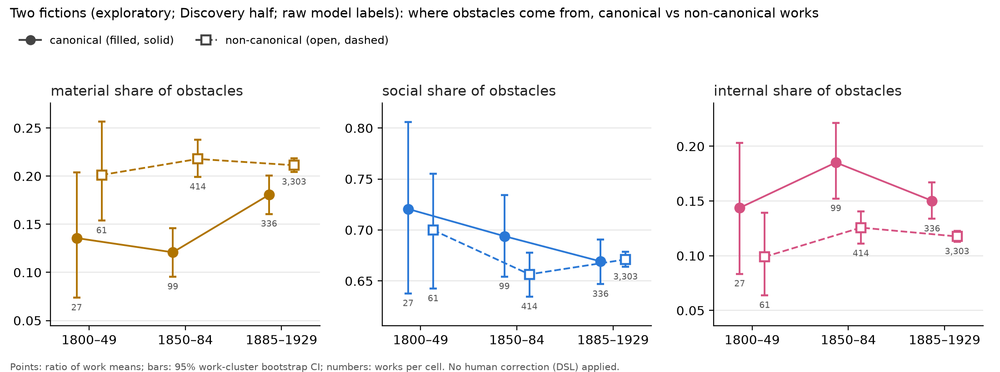

# Pilot analysis 2: two fictions (TF), exploratory, Discovery half (2026-11-04)

**Status: EXPLORATORY.** Discovery half only. These are **raw model labels**: no DSL, because there are no human audit labels yet. QA pass 2 puts the model's yes-precision at about 0.77, and its locus errors over-call material in late adventure and juvenile fiction (prereg §7.7). So nothing below is an effect size for the registered estimand. It tells us direction and fragility, nothing more. Confirmation labels were not read.

**Code.** `analysis/pilot_analysis_2_two_fictions.py --B 2000 --fig --examples`. Tables are in `analysis/stats/out/tf_pilot/report.md` (not committed). Figure: `analysis/figs/tf_pilot.png`.

## Data and estimator

| Item | Value |
|---|---|
| Labels | view `results` in `data/work/ald.duckdb` (deduped across the platform and Cloudflare sources), stage `label`, pin `41ca3c7d` (v0.9, gemma4 12B); valid schema only |
| Split | passages mapped to works with `pipeline/split_v2_map` and kept only if `split_v2 == discovery`. 0 non-Discovery rows were found, and they would have been dropped unread before parsing |
| Population | registered primary set `primary_v2_capv2`, **after the verified early dates of 2026-11-04** (`docs/canon_measure.md` §3.1); random backbone only (`stratum == random`); era = `era_v2` |
| Canonicity | `data/work/canon.parquet` `canonical` (author group's Wikidata item has ≥ 30 Wikipedia editions, house names never canonical) |
| Analysed | **46,684 passages from 4,240 works (1,509 author groups)**; 462 canonical works from 72 author groups |
| Shares | per work: obstacle rate and per-locus rate; locus share = Σ_w (obstacle and locus) / Σ_w obstacle, so each work counts equally (ratio of work means) |
| CIs | 95% percentile bootstrap, B = 2,000. **Work-cluster**, resampling works within era × canonical cells. Gaps and decompositions also carry an **author-group-cluster** CI, since the author is the registered clustering unit |

## 1. Locus shares and obstacle rate, canonical vs non-canonical

| Era | Stratum | Works | Authors | Passages | Obstacle rate | Material | Social | Internal |
|---|---|---|---|---|---|---|---|---|
| E | canonical | 27 | 11 | 288 | 0.714 [0.640, 0.779] | 0.136 [0.074, 0.204] | 0.721 [0.638, 0.806] | 0.144 [0.083, 0.203] |
| E | non-canonical | 61 | 38 | 675 | 0.659 [0.612, 0.702] | 0.201 [0.154, 0.257] | 0.700 [0.643, 0.755] | 0.099 [0.064, 0.139] |
| M | canonical | 99 | 20 | 1,091 | 0.720 [0.684, 0.757] | 0.121 [0.095, 0.146] | 0.694 [0.654, 0.734] | 0.185 [0.152, 0.222] |
| M | non-canonical | 414 | 219 | 4,519 | 0.720 [0.703, 0.736] | 0.218 [0.199, 0.238] | 0.656 [0.635, 0.678] | 0.126 [0.111, 0.140] |
| L | canonical | 336 | 61 | 3,720 | 0.707 [0.689, 0.725] | 0.181 [0.161, 0.200] | 0.669 [0.647, 0.691] | 0.150 [0.134, 0.167] |
| L | non-canonical | 3,303 | 1,259 | 36,391 | 0.722 [0.716, 0.728] | 0.211 [0.204, 0.218] | 0.671 [0.664, 0.678] | 0.118 [0.113, 0.123] |
| all | canonical | 462 | 72 | 5,099 | 0.710 [0.695, 0.726] | 0.165 [0.149, 0.180] | 0.678 [0.659, 0.697] | 0.157 [0.143, 0.173] |
| all | non-canonical | 3,778 | 1,437 | 41,585 | 0.721 [0.715, 0.726] | 0.212 [0.205, 0.218] | 0.670 [0.663, 0.677] | 0.118 [0.114, 0.123] |
| all | all | 4,240 | 1,509 | 46,684 | 0.719 [0.714, 0.725] | 0.207 [0.200, 0.213] | 0.671 [0.664, 0.677] | 0.122 [0.118, 0.127] |

**Canonical − non-canonical gap, in percentage points.** Each cell gives the work-bootstrap CI, then the author-bootstrap CI.

| Era | Material | Social | Internal | Obstacle rate |
|---|---|---|---|---|
| E | −6.6 [−14.7, +1.6] / [−14.6, +1.6] | +2.1 [−7.7, +12.3] / [−8.7, +13.3] | +4.5 [−2.9, +11.4] / [−4.7, +14.6] | +5.5 [−2.8, +14.0] / [−3.4, +15.7] |
| M | **−9.7** [−13.0, −6.4] / [−14.1, −4.5] | +3.7 [−0.7, +8.3] / [−6.1, +11.0] | **+6.0** [+2.3, +9.9] / [+1.5, +12.7] | +0.0 [−4.1, +4.1] / [−8.9, +6.7] |
| L | **−3.1** [−5.2, −1.0] / [−6.5, +0.6] | −0.2 [−2.5, +2.1] / [−3.8, +3.1] | **+3.3** [+1.5, +5.1] / [+0.2, +6.4] | −1.5 [−3.5, +0.4] / [−4.5, +1.3] |
| pooled, raw | −4.7 [−6.4, −3.0] / [−7.5, −1.8] | +0.8 [−1.3, +2.7] / [−2.7, +4.1] | +3.9 [+2.4, +5.5] / [+1.3, +6.5] | −1.1 [−2.7, +0.6] / [−3.8, +1.8] |
| **pooled, era-standardised** | **−3.9** [−5.8, −2.1] / [−6.9, −0.8] | +0.3 [−1.7, +2.3] / [−3.1, +3.4] | **+3.6** [+2.0, +5.2] / [+0.9, +6.4] | −1.2 [−2.9, +0.5] / [−3.9, +1.5] |

In the era-standardised row, each era's gap is weighted by that era's share of works. This avoids the raw pooled gap borrowing the early era's high canonical share.

**Reading:**
- **The direction is the TF direction in every era.** Canonical fiction gives a smaller share of its obstacles to the material world and a larger share to the mind. Under the prereg's classification this would read "inward": material down, internal up, social flat.
- **The obstacle rate itself does not differ** (71% vs 72%). The two fictions are equally full of trouble; the difference is in what kind.
- **The gap is mid-century, and it shrinks late.** In M the gap is about 10 pp of material share. In L it is about 3 pp, and its author-cluster CI touches 0. The E cell has only 27 canonical works from 11 authors, so it is too thin to say anything.
- **It is smaller than earlier figures.** The handoff's 6–11 pp gaps (all works, passage-pooled, catalog dates) and the literary review's 13–15 pp gaps (a 30-name canon) both exceed what we see in the registered primary set. That set excludes historical novels, caps prolific authors and applies the verified dates. Our era-standardised gap is −3.9 pp of material share.

## 2. Composition: how much of the aggregate era change is the falling canonical share?

This is a Bennet shift-share over the two canon strata: total = within-stratum + composition. The weights are each stratum's share of obstacles. Each cell gives the work-bootstrap CI, then the author-bootstrap CI.

| Contrast | Aggregate material share | Canonical share of obstacles | Total Δ (pp) | Within-stratum | Composition |
|---|---|---|---|---|---|
| E → L | 0.180 → 0.208 | 32% → 9% | +2.9 [−1.2, +6.8] / [−1.8, +7.5] | +1.7 [−2.7, +5.7] / [−2.9, +6.6] | **+1.1** [+0.2, +2.2] / [+0.0, +2.5] |
| M → L | 0.199 → 0.208 | 19% → 9% | +0.9 [−0.9, +2.6] / [−1.7, +3.6] | +0.3 [−1.6, +2.0] / [−2.2, +2.8] | **+0.7** [+0.5, +0.9] / [+0.0, +1.6] |
| E → M | 0.180 → 0.199 | 32% → 19% | +1.9 [−2.4, +6.2] / [−3.4, +7.1] | +0.9 [−3.5, +5.2] / [−4.1, +6.0] | +1.1 [+0.5, +1.7] / [−0.6, +2.7] |

The internal share works the same way. From M → L it changes by −1.7 pp [−3.0, −0.3] in total, of which −0.5 [−0.7, −0.3] is composition.

**Reading:**
- In the primary set the aggregate material share hardly moves (+0.9 pp from M → L; the CI includes 0). The pilot's +8 pp rise does not reappear. That pilot used codebook v0.5, catalog dates and 1,361 passages.
- **Of what change there is, most is composition.** From M → L, +0.7 of the +0.9 pp comes from the canonical share of obstacles halving (19% → 9%). From E → L it is +1.1 of +2.9 pp, and the within-stratum part has a CI that spans 0.
- This is the literary review's P1 point, in a weaker form. The archive's shift from canon to mass market makes a small "outward" trend of its own. Inside each stratum there is no detectable era trend in material share; the one exception is the canonical L cell, which rises to 0.18, discussed next.

## 3. Robustness

### 3a. Without LCSH-juvenile works

| Era | Material gap (pp) | Internal gap |
|---|---|---|
| E | −6.3 [−15.0, +2.5] | +4.6 [−3.5, +11.6] |
| M | −5.7 [−9.2, −2.5] | +5.7 [+2.0, +9.3] |
| L | **−0.1** [−2.2, +2.1] | +1.9 [+0.0, +3.9] |
| pooled, era-std | −0.9 [−2.8, +1.0] / author [−4.0, +2.0] | +2.4 [+0.6, +4.1] / author [−0.1, +5.4] |

**The late material gap is a juvenile-fiction gap.** Drop the juvenile works and the late non-canonical material share falls from 0.211 to 0.173, the same as the canonical 0.172. The prereg's TF estimand deliberately does not adjust for genre, because genre mix is part of what separates the two fields. So this does not invalidate TF. But it does mean that a late TF effect is "the canon has fewer boys' books". The mid-century gap (−5.7 pp) and the internal gap survive.

### 3b. Quote-hallucinated rows dropped
223 rows are dropped. The gaps barely change: era-standardised material −4.0 pp [−5.7, −2.1], internal +3.6 [+2.0, +5.2].

### 3c. Who is "canonical"?
- The measure is present-day Wikipedia fame, not literary prestige. In L, the canonical works with the most labelled passages come from Henry James (20 works), Wodehouse (15), Conan Doyle (15), Galsworthy (14), Barrie (13), Haggard (13), Edgar Wallace (12) and Upton Sinclair (12).
- Doyle, Haggard and Wallace write material-heavy plots (shares 0.22–0.25). That is one reason the late canonical material share is 0.18 rather than the literary review's 0.08.
- In M, the 99 canonical works come from only 20 author groups (Trollope 18, Collins 15, MacDonald 10, Harte 10, Eliot 8, Gaskell 8). Leaving any one author out keeps the M gap between −7.7 and −10.3 pp.
- In L, leaving one author out keeps the gap between −2.0 and −3.5 pp.

### 3d. A second model (qwen 3.5 9B, `alt_label`, pin `ca0c1188`) on overlapping passages
`alt_label` covers a hash-random 10% of the Discovery rand_a backbone. Within the analysed population, **3,459 passages from 2,414 works (286 canonical)** carry both labels.

The two models disagree sharply on what counts as an obstacle:
- the obstacle rate is 0.72 under gemma and **0.30 under qwen**;
- they agree on has_obstacle for 0.56 of passages;
- they agree on locus for 0.74 of the 1,003 passages that both call obstacles.

| Model | Era | Material gap (pp) | Social gap | Internal gap | Material share, canon / non-canon (works) |
|---|---|---|---|---|---|
| gemma | M | −3.4 [−14.7, +8.0] | −3.1 [−19.8, +10.9] | +6.5 [−5.0, +18.7] | 0.185 / 0.219 (59 / 232) |
| gemma | L | +5.6 [−0.2, +12.6] | −9.9 [−16.8, −2.5] | +4.3 [−0.8, +9.6] | 0.263 / 0.207 (214 / 1,865) |
| gemma | pooled, era-std | +4.3 [−0.9, +10.2] | −8.7 [−15.3, −2.5] | +4.3 [−0.3, +9.4] | |
| qwen | M | +0.8 [−18.2, +21.1] | +6.2 [−15.7, +28.9] | −7.1 [−22.4, +8.1] | 0.205 / 0.196 (59 / 232) |
| qwen | L | −0.6 [−10.5, +9.2] | +6.1 [−3.9, +17.2] | −5.5 [−11.3, +1.5] | 0.204 / 0.210 (214 / 1,865) |
| qwen | pooled, era-std | −0.7 [−9.6, +7.4] | +6.3 [−3.2, +16.1] | −5.5 [−10.8, +0.4] | |

(E has 13 canonical works on the overlap and is omitted; see the report file.)

**Reading: the check is inconclusive, and it leans against robustness.**
- On this 10% subsample even gemma's late material gap has the opposite sign from the full sample (+5.6 vs −3.1). The overlap's 317 canonical late passages give a canonical material share of 0.25, against 0.17 for the other 3,403 passages. The overlap is too small to settle anything about a 3–4 pp gap.
- Qwen shows **no canonical material gap** and an internal gap of the opposite sign (−5.5 pp). It also calls 60% fewer obstacles, so the two models are not measuring the same construct.
- At best, the TF gap is **not shown to survive a change of model**. This is the strongest reason to treat the pilot direction as a hypothesis for the expert-anchored Confirmation test, not as a finding.

## 4. What this means for the registered test
- The prereg's power analysis assumes a TF material gap of about −9.6 pp (`tf_full`; power 0.70) or −6.6 pp (`tf_half`; power 0.37). In the registered population, the raw-label gap is −3.9 pp after standardising across eras. Most of the weight is on L, where the gap is −3.1 pp.
- Raw labels can both attenuate and exaggerate, so this is not a power estimate. But if the expert-construct gap is near the raw one, **TF is likely to be null at the registered MDE of about 9 pp**. The internal component, about +3.6 pp against an MDE of about 8 pp, faces the same problem.
- The prereg already commits to reporting nulls with the MDE. These numbers argue for wording the DH2027 and SRW drafts so that the paper stands if TF comes out null.

## 5. Example passages (Discovery; quotes verified verbatim against `data/work/passages.parquet`)
Each quote is the model's `evidence_quote` (quote_status `exact`), re-checked by substring match. Years are `year_v2`.

| Locus | Canonical (≥ 30 Wikipedia editions) | Non-canonical |
|---|---|---|
| **material** | Hawthorne, *Fanshawe* (1828): "The difficulties of the road had been so much increased by the storm" | Ely, *The Boy Chums in the Forest* (1910): "Charley's shoulder was still too sore to permit of his using the paddle" |
| **social** | Irving, *Tales of a Traveller* (1824): "I had no wealth nor prospects to entitle me to her hand." | Miller, *Come Out of the Kitchen!* (1916): "The facts, Cora intimated, were terrible. She was already engaged." |
| **internal** | Trollope, *Rachel Ray* (1863): "And who had closed the gates? Her own hands had done it." | Aiken, *The River* (1914): "If only she did not feel so tired! So strangely old!" |

**A caution for teaching.** The model's lines are blurry. For example, Cullum's *The Golden Woman* (1916), "he was hurled headlong down the precipitous path", is coded material, but the passage says he "had been struck with fearful force from somewhere behind him", which is an assault. Aiken's fatigue sits between body and mind. These boundary cases are what the human audit is for.

## 6. Caveats
1. Raw model labels, no DSL (§0). The QA error pattern, which over-calls material in late adventure and juvenile fiction, loads directly onto the non-canonical late cell.
2. Canonicity is present-day fame (sitelinks), not historical prestige (§3c).
3. The verified early dates are agent-reviewed and not yet human-signed (`docs/canon_measure.md` §3.1). E has 88 analysed works.
4. The bootstrap CIs are descriptive. They are not the registered CR1 sandwich, and there is no g-computation standardisation over origin and length.
5. These numbers were produced after TF was chosen as the primary test (Nov 1) and before the OSF registration. They must not change the registered estimand. If they inform wording, that use is logged as exploratory.
